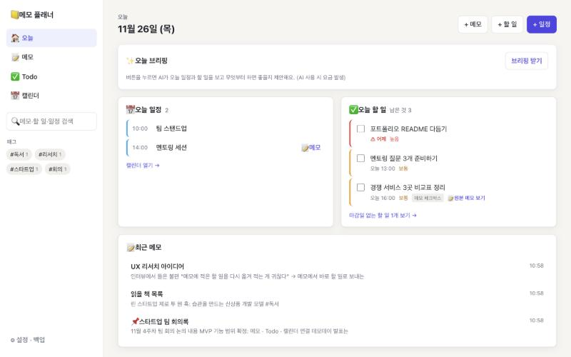
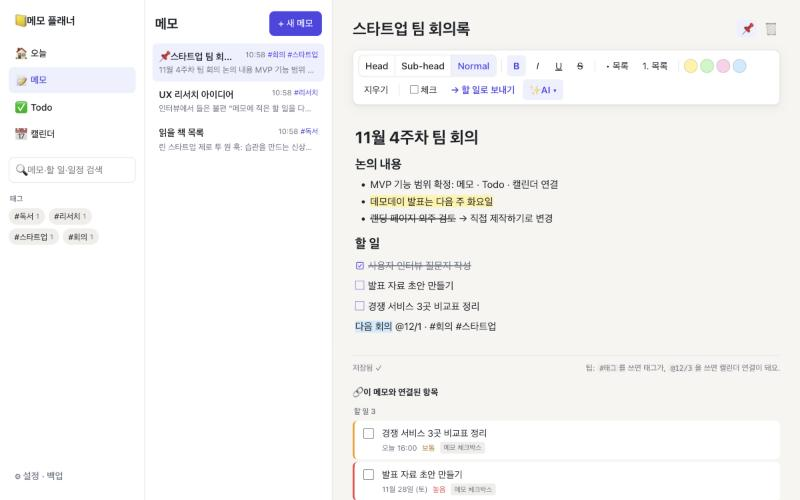
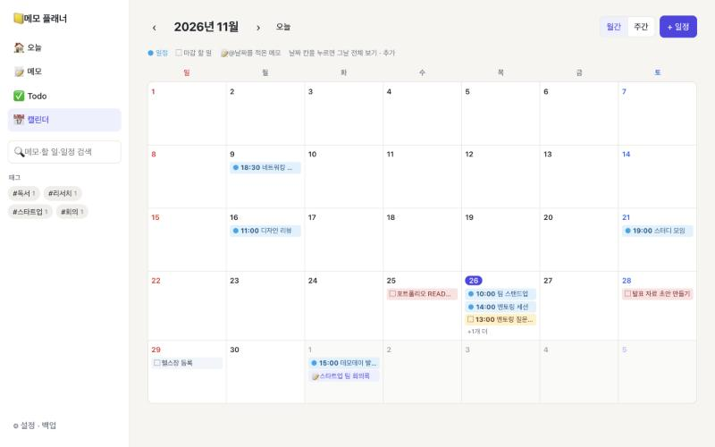
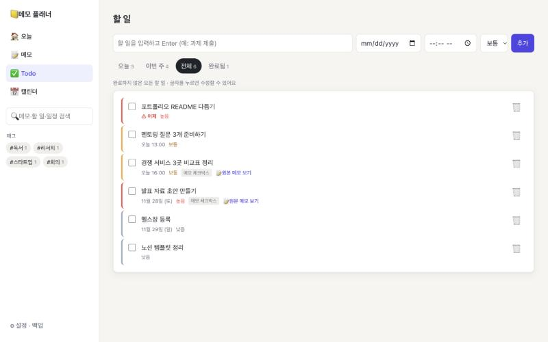
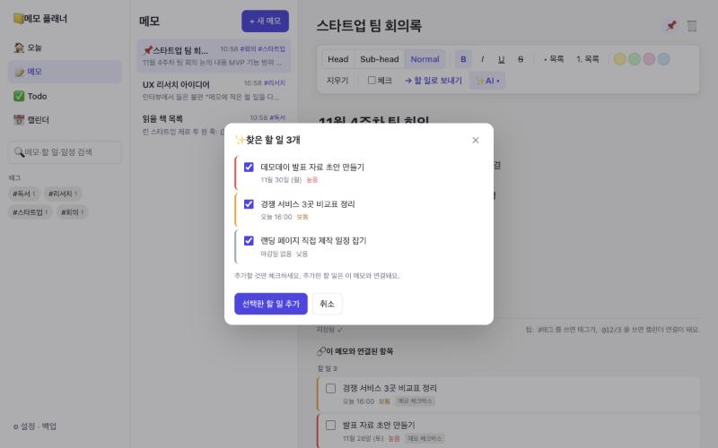
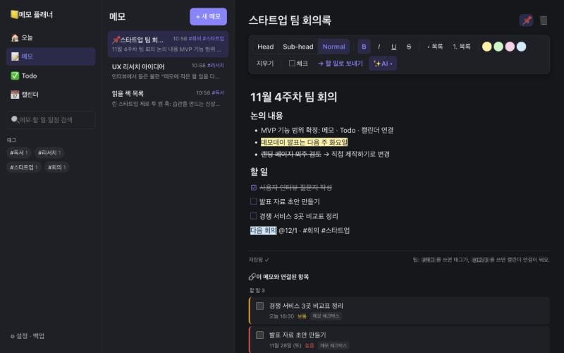

# 📒 메모 플래너

메모 · Todo · 캘린더를 한 화면에서 쓰고 **서로 연결**하는 개인 생산성 웹앱입니다.
"적고(메모) → 할 일로 바꾸고(Todo) → 날짜에 올리는(캘린더)" 흐름을 한 앱에서 끝내는 것이 목표입니다.

### 🌐 [웹에서 바로 체험하기 → memo-planner-sigma.vercel.app](https://memo-planner-sigma.vercel.app)
설치 없이 브라우저에서 메모 · Todo · 캘린더를 써 볼 수 있어요. 데이터는 내 브라우저에만 저장돼요.
웹 체험 버전에서는 ✨ AI 기능이 꺼져 있어요. AI는 내려받아 실행할 때 쓸 수 있어요.

> 국민대학교 AX-Startup 부트캠프 실습으로 Claude Code와 함께 만든 프로젝트입니다.
> 기획 문서: [PRD.md](PRD.md) · AI 설계: [PLAN-2단계-AI.md](PLAN-2단계-AI.md)



## 화면 미리보기

| 메모 편집 (제목 단계 · 형광펜 · 취소선 · 체크박스) | 캘린더 (일정 · 마감 할 일 · 날짜 메모) |
|---|---|
|  |  |
| **Todo (우선순위 · 마감일 · 원본 메모 연결)** | **✨ AI 할 일 찾기 (미리보기 후 선택해서 추가)** |
|  |  |

<details>
<summary>🌙 다크 모드</summary>



</details>

> 스크린샷은 가상의 예시 데이터로 찍었어요. AI 화면은 예시 응답으로 띄운 화면 예시입니다.

## 주요 기능

### 1단계 (AI 없이 동작)
- **메모**: Head / Sub-head / Normal 제목 단계, 굵게·기울임·밑줄·취소선, 형광펜 4색, 목록, 체크박스 줄, `#태그`, 고정, 검색
- **Todo**: 마감일·시간, 우선순위(높음·보통·낮음), 오늘 / 이번 주 / 전체 / 완료 보기
- **캘린더**: 월간·주간 보기, 일정 추가, 날짜 칸에 일정 · 마감 할 일 · `@12/3` 메모를 함께 표시
- **연결 기능**
  - 메모 문장 → "할 일로 보내기"
  - 메모 체크박스 ↔ Todo 완료 상태 동기화
  - 일정 → 메모 쓰기, 원본 메모로 돌아가기
- **오늘 대시보드**, 다크 모드, 백업 파일 내보내기 · 불러오기
- 데이터는 브라우저 저장소(localStorage)에 저장됩니다. 서버에는 저장되지 않습니다.

### 2단계 (✨ AI, Claude CLI 로그인 또는 Claude API 키)
| 기능 | 설명 |
|---|---|
| 3줄 요약 | 긴 메모를 3줄로 요약해 메모 맨 위에 추가 |
| 할 일 찾기 | 메모에서 할 일 후보를 찾아 골라서 Todo에 추가 |
| 한 줄 입력 | "다음 주 화요일 3시 팀 회의" → 날짜 · 시간 · 제목 자동 채움 |
| 태그 추천 | 메모 내용에 맞는 태그 후보 추천 |
| 글 다듬기 | 선택한 문장의 맞춤법 · 문장 정리 |
| 오늘 브리핑 | 오늘 일정 · 할 일로 순서 제안 |
| 대화로 추가 | 오늘 대시보드의 💬 버튼 → "오늘은 뭐하세요?"에 답하면 일정 · 할 일을 찾아 확인 후 추가 |

AI 결과는 모두 **미리보기로 먼저 보여 주고**, 사용자가 확인해야 반영됩니다.

## 실행 방법

필요한 것: Python 3 (Mac은 기본 설치되어 있는 경우가 많아요)

1. 이 저장소를 내려받습니다.
   - GitHub 화면의 **Code → Download ZIP**을 누르고 압축을 풉니다.
2. 실행 파일을 더블클릭합니다.
   - Mac: `시작하기.command`
     - "확인되지 않은 개발자" 경고가 뜨면 **우클릭 → 열기**를 누르세요.
   - Windows: `시작하기.bat`
3. 브라우저에서 `http://localhost:3000`이 열립니다.
   - 처음 실행할 때는 AI용 패키지를 자동으로 설치해서 1~2분 걸릴 수 있어요.
4. 끄려면 터미널 창을 닫습니다. (설정 창에 '프로그램 끝내기' 버튼이 보이면 그걸 눌러도 돼요.)

ZIP으로 받은 Mac 파일이 실행되지 않으면, 터미널에서 이 폴더로 이동한 뒤 아래 명령을 한 번 실행하세요. 시작 파일에 실행 권한을 주는 명령이에요.
```bash
chmod +x 시작하기.command AI키설정하기.command
```

## AI 기능 켜기 (선택)

AI 기능은 아래 **두 방법 중 하나**로 켤 수 있어요. 앱은 **Claude CLI(로그인) 방법을 먼저** 시도하고, 안 되면 API 키를 써요. 둘 다 없어도 1단계 기능은 모두 쓸 수 있어요.
설정 창(⚙)의 **AI 연결 상태** 줄에서 어떤 방식으로 연결됐는지 볼 수 있어요.

### 방법 1: Claude CLI로 로그인 (Claude 구독 사용, 추천)
**Claude CLI**는 내 컴퓨터에 설치하는 Claude 프로그램이에요. 로그인해 두면 앱이 그 로그인을 이용해요. 이때는 **내 Claude 구독 사용량에서 차감**돼요.

1. 터미널을 엽니다. (Mac: Spotlight에서 "터미널" 검색)
2. 아래 한 줄을 붙여 넣고 Enter를 누릅니다. (Anthropic 공식 설치 주소예요. 설치가 끝나면 완료 안내가 보여요.)
   ```bash
   curl -fsSL https://claude.ai/install.sh | bash
   ```
3. 터미널에 `claude`를 입력하고 Enter를 누릅니다. 브라우저가 열리면 Claude 계정으로 로그인하세요.
4. 앱에서 ✨ 버튼을 다시 누르거나 설정 창을 열어 **"✅ Claude CLI로 연결됨"**이 보이는지 확인합니다.

### 방법 2: API 키 (쓴 만큼 API 요금 발생)
1. [platform.claude.com](https://platform.claude.com)에서 결제 수단을 등록하고 API 키를 발급합니다.
2. 키를 앱에 넣습니다.
   - Mac 개발 폴더: `AI키설정하기.command`를 더블클릭하고 키를 붙여 넣습니다.
   - 그 외: 프로젝트 폴더의 `.env` 파일(없으면 `.env.example`을 복사해 이름을 `.env`로 변경)에 `ANTHROPIC_API_KEY=키` 한 줄을 적습니다. `.env`가 있는 정확한 위치는 앱의 "설정 방법 보기" 창에 표시돼요.
3. ⚠️ `.env` 파일과 API 키는 절대 GitHub에 올리거나 다른 사람과 공유하지 마세요. 채팅이나 스크린샷에도 올리지 마세요. 이 저장소는 `.gitignore`로 `.env`를 제외합니다.

✨ 버튼을 누르면 해당 메모 내용이 Anthropic으로 전송됩니다. 다른 사람의 개인정보나 비밀번호가 담긴 내용에는 사용하지 마세요.

## MemoMate 단독 프로그램 (Mac 앱 / Windows exe)

Python이나 터미널 없이 **더블클릭만으로** 실행하는 단독 프로그램 형태로도 만들 수 있어요.

**현재 상태 (솔직하게)**
- **Mac 앱**: Apple 칩(arm64) Mac에서 만들어 직접 실행해 확인했어요. 화면 · AI 연결 · 종료 버튼 · 두 번 실행 · 파일 비공개가 정상이었어요. Intel Mac은 확인하지 못했어요.
- **Windows exe**: GitHub에서 만들도록 설정(`.github/workflows/build.yml`)만 해 두었고, **실제로 실행해 본 결과는 아직 확인하지 못했어요.**

**프로그램 만드는 방법**
- **Mac**: `build_mac.command`를 더블클릭하면 몇 분 뒤 `dist/MemoMate.app`이 만들어져요. (인터넷 필요, 패키지는 폴더 안 `.venv`에만 설치돼요.)
- **Windows**: GitHub 저장소의 **Actions → Build Windows app → Run workflow**를 누르면 Windows 서버에서 만들어 `MemoMate-windows` 파일(zip)로 내려받을 수 있어요.

**사용 방법**

1. 내려받은 프로그램을 실행합니다. (Mac: MemoMate 앱 / Windows: exe 파일)
2. 서명이 안 된 프로그램이라 처음에 경고가 뜰 수 있어요. 아래 방법으로 넘어갑니다.
   - **Mac**: 앱을 더블클릭했을 때 열리지 않으면 **시스템 설정 → 개인정보 보호 및 보안**으로 이동해 아래쪽의 MemoMate 항목에서 **"그래도 열기"**를 누릅니다.
   - **Windows**: "Windows의 PC 보호" (SmartScreen) 창이 뜨면 **추가 정보 → 실행**을 누릅니다.
3. 브라우저에서 앱 화면이 열립니다. (터미널 창은 보이지 않아요.)
4. AI를 쓰려면 위의 **Claude CLI 설치·로그인**(방법 1)을 먼저 해 두세요.
5. **끝내기**: 앱 화면의 **⚙ 설정 → 프로그램 끝내기** 버튼을 누르고 확인하면 프로그램이 종료돼요. "프로그램을 종료했어요. 이 탭은 닫아도 돼요."가 보이면 브라우저 탭을 닫으면 됩니다. 저장된 메모 데이터는 그대로 남아 있어요. (이 버튼은 단독 프로그램처럼 서버가 종료를 지원할 때만 보여요.)

## 구조

```
index.html        화면 틀
css/style.css     디자인 (라이트·다크 모드)
js/store.js       데이터 저장과 메모·할 일·일정 연결
js/app.js         메뉴 전환, 팝업, 검색, 설정·백업
js/memo.js        메모 편집기
js/todo.js        Todo
js/calendar.js    캘린더
js/dashboard.js   오늘 대시보드
js/ai.js          ✨ AI 버튼과 미리보기
server.py         로컬 서버 (화면 제공 + AI 중계, 포트 3000)
```

- 화면은 HTML · CSS · JavaScript만으로 만들었습니다. 별도 프레임워크는 쓰지 않았습니다.
- `server.py`는 API 키·로그인 정보를 브라우저에 노출하지 않으려고 만든 중계 서버입니다. AI 모델은 `server.py`의 `MODEL` 값에서 바꿀 수 있습니다. 기본값은 `claude-opus-5-5`입니다.
